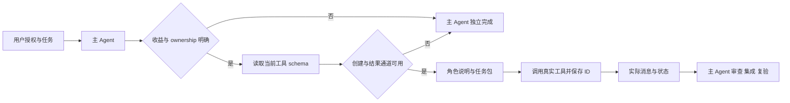

# Subagent Runtime 接入设计

2026-10-29：旧固定接口方案已由能力发现替代。运行规则唯一维护于[编排准则](../references/subagent-orchestration.md)；本文件只说明接入边界，不保存第二套参数样例。

## 调用链

- Skill、角色和模板不会自行调用工具，shell/hooks 只用于正常命令和测试。
- 同一任务中复用明确的 Subagent 授权；讨论接口升级本身不是实际使用授权。
- 参数、并发限制、模型继承、上下文及等待语义由宿主决定；没有关闭能力就不虚构关闭工具。
- 生产发布、回滚、迁移执行、环境变量修改和破坏性清理不交给子代理。

## 输入与输出

[任务包](../templates/subagent-task-brief-template.md) 包含目标、最小上下文、可读/可写范围、禁止事项、验证与退出条件。并行写范围不重叠，依赖契约先冻结。

按[结果模板](../templates/subagent-result-template.md) 核验产物、命令、证据、失败与残余风险，再记录收益、冲突和复验成本；创建/等待结束都不等于任务完成。

独立 forward-test 也需真实子代理及副作用授权；未允许时只做静态或隔离脚本验证，明确证据限度。
